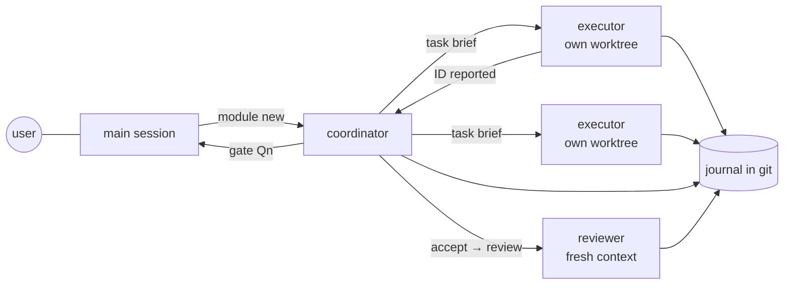

# dpcli

**Run a team of Claude Code agents on a real codebase — with a journal, acceptance checks, isolated worktrees, and a process that improves itself.**

[](https://github.com/thegriglat/dpcli/actions/workflows/test.yml)


[](LICENSE)

One main session plans. A coordinator per module writes contracts and task cards. Executors each work on one task in their own git worktree. A reviewer with a fresh context checks risky work. dpcli is the single CLI they all use to hand work over — so agents exchange **IDs and commands, not walls of text**, and every decision, report and verdict lands in an append-only journal in git.

```
$ .dpcli/dpcli task brief BL-1          # the whole message a coordinator sends an executor
BL-1 dp-engineer: Invoice totals
Copy: ~/worktrees/app/billing-BL-1  branch: billing/BL-1 (from feature/billing)
Do: .dpcli/dpcli task show BL-1  · plan: .dpcli/dpcli plan billing <section>
Scope: only src/billing.py
Done when: .dpcli/dpcli accept BL-1 --dry → PASS; report: build/dpcli/BL-1/report.json → .dpcli/dpcli report BL-1
Reply: one line «BL-1 reported» | «BL-1 blocked: <reason ≤15 words>» | «BL-1 contract: <what to change>»

$ .dpcli/dpcli accept BL-1 --dry
PASS unit  exit 0
PASS scope 1 file(s) within bounds
BL-1: 1/1 in .

$ .dpcli/dpcli status
billing: created 1 | event 0m ago | feature/billing 6509356 0m @ .
  BL-1 created 0m engineer billing/BL-1 1900700 0m
  ? Q1 awaits decision (0m): Round tax per line or per invoice?
```

## Why

Multi-agent coding falls apart in predictable ways: agents retell each other's context and burn tokens, edit files outside their task, "pass" by weakening tests, overwrite each other's work, and repeat the same mistakes forever. dpcli turns these into mechanics:

| Problem | dpcli |
|---|---|
| Context bloat between agents | A message protocol of one-line IDs; details are read from the journal on demand |
| Agents wander outside the task | Task cards with `scope` / `dont_touch`; `accept` fails on out-of-scope changes |
| "Done" that isn't | Executable acceptance checks with thresholds; risk-based fresh-context review |
| Agents trample each other | One git worktree and branch per task; locks for CPU/GPU-heavy runs |
| Same frictions every week | Agents log frictions as they work; `dpcli feedback` clusters them for a retro; project fixes live in `.dpcli-local/` |

> **Status:** released — the core (journal, cards, acceptance, worktrees, delivery), the installer, the friction ledger (`feedback`, `stats`), guard hooks (shell edits, main-session context). See [ROADMAP.md](ROADMAP.md).

## Quick start

In the root of an existing git project:

```sh
curl -fsSL https://raw.githubusercontent.com/thegriglat/dpcli/main/install.sh | bash
# options: --lang ru --commit-lang en --tools (install rg, fd, jq, ast-grep) --yes
```

The installer copies dpcli into the folder `.dpcli` (committed with the project, no submodule), asks which language agents should write in (and, separately, commit messages), creates `dpcli.yml`, and runs `.dpcli/dpcli init` — agents, skills and the process description land in `.claude/`. Commit the result; to update, run `bash .dpcli/install.sh`. Then in Claude Code:

```
> Read .claude/dpcli-workflow.md and plan module "billing" from docs/plan/billing.md
```

Requirements: git, Python ≥ 3.10. No other dependencies.

## How it works



- **Journal** — `docs/plan/<module>/`: cards, reports, reviews, `events.jsonl`, `decisions.jsonl`. Append-only, readable by humans (`render`) and agents (`status`, `log`, `inbox`, `search`).
- **Cards and acceptance** — `task new` with scope, checks (`exit=0`, regex, numeric thresholds, test filters), contracts; `accept` runs them and records PASS/FAIL.
- **Branches and copies** — module and task branches, one worktree per task, `merge`, `deliver` (squash a finished module into its base), `gc`.
- **Long runs** — `job start/wait` and shared `lock cpu|gpu` so agents don't poll or collide.

Full reference: [docs/guide.md](docs/guide.md).

## Improving the process

1. Agents log frictions as one line while they work (`dp_feedback`, `harness: …` notes).
2. `dpcli feedback` clusters them, `dpcli stats` measures rework and tokens; the `harness-retro` skill proposes ≤ 3 changes to the user.
3. Project-specific fixes go into the project's `.dpcli-local/` (survives updates); dpcli-level ones come back here as issues or PRs written by a human.

## Contributing

PRs are welcome — see [CONTRIBUTING.md](CONTRIBUTING.md). Tests: `python3 -m unittest discover -s tests`.

## License

[MIT](LICENSE)
